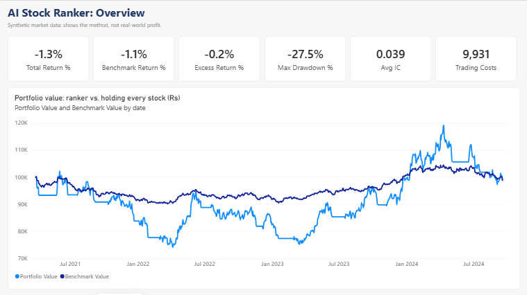
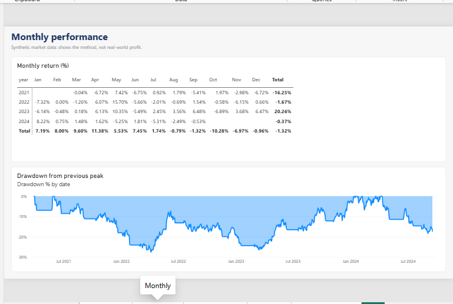
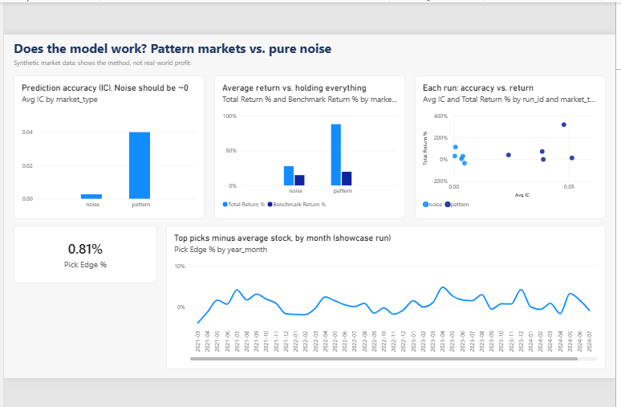
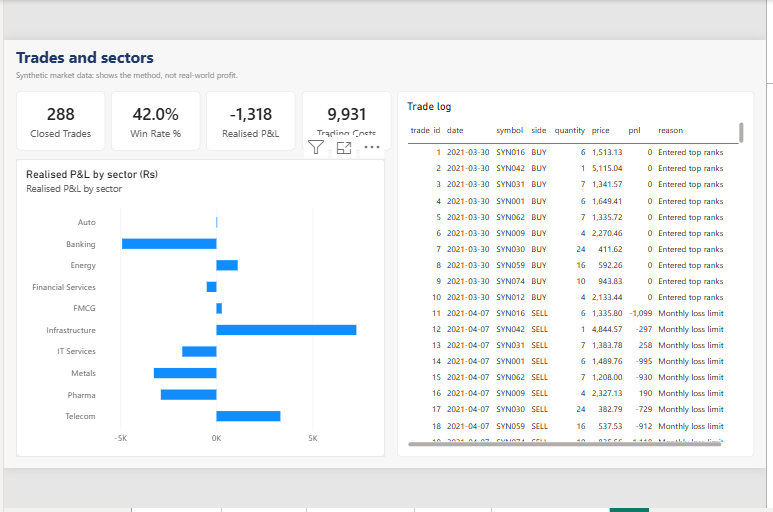
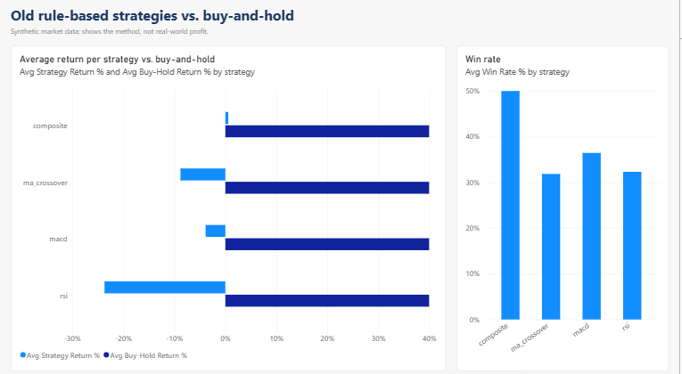

# Algotrader: ML stock ranking for Indian equities

An end-to-end data project for NSE/BSE stocks. It covers the full path a data analyst works through: generating and modelling data in **Python**, storing it in a **SQL** star schema, analysing it with SQL queries, and reporting it in **Excel** and **Power BI**.

> **Results here come from synthetic (simulated) markets, not real NSE/BSE prices.** They show the pipeline works end to end and that the model is tested honestly. They are not evidence that it makes money. Real-data validation and paper trading are next. Not financial advice.



## What it does

1. **Simulates a market** of 100 stocks over 6 years. Half the runs hide a weak, persistent pattern in returns. The other half are pure noise.
2. **Builds features** for every stock and day: momentum, volatility, RSI, MACD and volume. They are rank-normalised across stocks.
3. **Trains a model walk-forward** (scikit-learn gradient boosting). It is always tested on a period it has never seen, with a gap so future data can't leak in.
4. **Builds a portfolio:** it holds the top 10 ranked stocks, rebalances monthly, pays realistic Zerodha charges and slippage, and applies a 5% monthly loss cap.
5. **Checks itself against luck.** The model passes only if it finds skill when a pattern exists *and* finds none on pure noise.
6. **Loads everything into SQLite**, runs 9 SQL analysis queries, and builds an Excel report and a 5-page Power BI dashboard.

## Results (synthetic, 5 market seeds each, after costs)

| Market | Avg IC (rank correlation) | Avg return | Hold-all benchmark | Beat benchmark | Worst drawdown |
|---|---|---|---|---|---|
| With hidden pattern | **+0.040** | +87.7% | +19.5% | 4 / 5 | 28.7% |
| Pure noise | **+0.003** | +27.6% | +14.7% | 3 / 5 | 37.0% |

**Verdict: PASS.** The model finds the pattern when it exists and shows near-zero skill on noise.

**What I learned:** the noise portfolios still beat the benchmark in 3 of 5 runs, by pure luck. Returns alone would have made a useless model look good. That's why the project judges the model by IC (does the ranking predict next month's order?) and not by profit.

**Known weak spots:** the monthly loss cap is checked at daily opens, so a gap can overshoot it (worst month −7.5% against a 5% cap). Drawdowns of 29–37% are too high for real money.

## Dashboards

### Power BI (5 pages, 7 tables, 8 relationships, 22 DAX measures)

| Page | Shows |
|---|---|
| Overview | 6 KPI cards, portfolio value vs. holding every stock |
| Monthly | Monthly returns matrix, drawdown from peak |
| Model check | IC for pattern vs. noise markets, return vs. accuracy per run, monthly pick edge |
| Trades | Trade KPIs, realised P&L by sector, full trade log |
| Rule strategies | RSI, MACD and MA crossover vs. buy-and-hold, win rates |






The report is a Power BI Project (`powerbi/Algotrader/Algotrader.pbip`): the model is plain-text TMDL and the pages are PBIR JSON, so it is version-controlled and generated by code (`src/reporting/powerbi.py`). See [powerbi/POWERBI_GUIDE.md](powerbi/POWERBI_GUIDE.md) for the data model and DAX.

### Excel and SQL

- `data/Algotrader_Report.xlsx`: KPIs, monthly returns heatmap, equity chart, accuracy by decile, sectors and the full trade log.
- `sql/schema.sql`: star schema with `dim_run`, `dim_date`, `dim_stock`, `fact_price`, `fact_prediction`, `fact_trade`, `fact_portfolio_daily` and `fact_strategy_backtest`.
- `sql/analysis/*.sql`: 9 queries using CTEs and window functions (`LAG`, `NTILE`, `RANK`, `PERCENT_RANK`, running `MAX`). Examples are drawdowns, model accuracy by decile, pick hit rate by quarter and cost drag by year.

## Tech stack

| Area | Tools |
|---|---|
| Python | pandas, NumPy, scikit-learn, pytest (23 tests) |
| SQL | SQLite star schema, analysis queries |
| Excel | openpyxl report with charts and conditional formatting |
| Power BI | PBIP / TMDL semantic model, DAX, PBIR report |
| App | Streamlit paper-trading dashboard, Zerodha Kite Connect (optional) |

## Roadmap

- [x] Cost-aware backtester (next-open fills, gap-aware stops, Zerodha charges)
- [x] Walk-forward ML ranker with a noise control
- [x] SQL + Excel + Power BI reporting
- [ ] Re-run on real NSE prices (yfinance)
- [ ] Paper trade for 4–6 weeks
- [ ] Fix the loss-cap overshoot

---

## Quick start

```powershell
git clone https://github.com/kolambekarpratik123-source/algotrader.git
cd algotrader
python -m venv .venv
.venv\Scripts\activate
pip install -r requirements.txt
python main.py init
```

### Paper trading

```powershell
python main.py run --strategy rsi --cycles 20 --interval 5
python main.py status
```

### Backtest a strategy (daily data, after costs)

```powershell
# Synthetic random data: checks the code runs, says nothing about real markets
python main.py backtest --source synthetic --strategy rsi

# Real NSE daily prices from Yahoo Finance (cached in data/history/)
python main.py backtest --source yfinance --symbol RELIANCE --strategy macd --years 5
```

### Baseline: all strategies vs buy-and-hold

```powershell
python main.py baseline --source synthetic          # code check
python main.py baseline --source yfinance --years 5 # the numbers that count
```

Results go to `data/baseline_results.json`. Any new model has to beat these.

Backtests now include Zerodha delivery charges (STT, stamp duty, exchange and SEBI fees, GST, DP charge) and 0.05% slippage per side. Signals fill at the next day's open, and stop-losses fill at the open if the price gaps past them. Edit `src/backtest/costs.py` if charges change.

### AI stock ranker (synthetic markets for now)

```powershell
python main.py ranker                 # 5 random markets, with and without a hidden pattern
python main.py ranker --signal 0      # pure noise: the model should find nothing
```

Scores 100 stocks on momentum, volatility, RSI, MACD and volume features, trains walk-forward (never on the period it's tested on), holds the top 10 and rebalances monthly, after costs, with a 5% monthly loss cap. It passes only if it finds the pattern when one exists and shows near-zero skill (IC) on pure noise. Code: `src/ml/`. Results: `data/ranker_results.json`.

### Reporting: SQL + Excel + Power BI

```powershell
python main.py report
```

One command runs the ranker and builds:

| Output | What it is |
|---|---|
| `data/algotrader.db` | SQLite star schema (`sql/schema.sql`): `dim_run`, `dim_date`, `dim_stock`, `fact_price`, `fact_prediction`, `fact_trade`, `fact_portfolio_daily`, `fact_strategy_backtest` |
| `sql/analysis/*.sql` | 9 analysis queries (CTEs, window functions: `LAG`, `NTILE`, `RANK`, `PERCENT_RANK`, running `MAX`) |
| `data/Algotrader_Report.xlsx` | Excel report: KPIs, monthly returns heatmap, equity chart, model accuracy by decile, sectors, full trade log |
| `data/exports/*.csv` | Every table as CSV for Power BI |
| `powerbi/POWERBI_GUIDE.md` | Data model, DAX measures and page layout for the Power BI dashboard |

Every run is tagged with `data_source` (`synthetic` today, `nse` later), so real data drops into the same schema.

### Run tests

```powershell
python -m pytest tests
```

### Launch dashboard

```powershell
python main.py dashboard
```

Open http://localhost:8501 — view portfolio, trades, equity curve, and run backtests from the UI.

### List strategies

```powershell
python main.py strategies
```

---

## Strategies

| Name | Logic |
|------|-------|
| `ma_crossover` | Fast/slow MA golden cross + RSI filter |
| `rsi` | Buy on RSI crossing above 30, sell above 70 |
| `macd` | Buy on MACD crossing above signal line |
| `composite` | Requires 2+ strategies to agree before entry |

Set default in `.env`: `STRATEGY=rsi`

---

## Live BSE data (Zerodha Kite)

1. Create app at [kite.trade](https://kite.trade/)
2. Generate access token (daily refresh required)
3. Configure `.env`:

```env
TRADING_MODE=live
EXCHANGE=BSE
KITE_API_KEY=your_key
KITE_API_SECRET=your_secret
KITE_ACCESS_TOKEN=your_token
```

4. Run with live data + WebSocket ticks:

```powershell
python main.py run --strategy composite
```

Live orders use CNC product type on Kite. Ensure SEBI algo approval from your broker before automated live trading.

---

## Project structure

```
Algotrader/
├── main.py                     # CLI
├── dashboard/app.py            # Streamlit UI
├── src/
│   ├── engine.py               # Live trading loop
│   ├── backtest/engine.py      # Historical backtesting
│   ├── data/
│   │   ├── mock_provider.py    # Paper trading data
│   │   ├── kite_provider.py    # Live REST + WebSocket
│   │   └── kite_websocket.py   # Real-time ticks
│   ├── strategies/
│   │   ├── ma_crossover.py
│   │   ├── rsi.py
│   │   ├── macd.py
│   │   ├── composite.py
│   │   └── registry.py
│   ├── risk/manager.py         # Stop-loss, daily limits
│   ├── execution/
│   │   ├── paper.py
│   │   └── kite.py             # Live order placement
│   ├── storage/state.py        # Persist state for dashboard
│   ├── ml/                     # AI ranker: synthetic market, features, walk-forward model, portfolio
│   └── reporting/              # SQLite loader, Excel builder, CSV exports
├── sql/                        # schema.sql + analysis/*.sql
├── powerbi/POWERBI_GUIDE.md    # Power BI build guide
├── tests/                      # pytest suite
└── data/                       # Runtime state (auto-created)
```

---

## Risk management

Every trade gets automatic stop-loss and take-profit. Trading halts if daily loss exceeds `MAX_DAILY_LOSS_PCT`. Position size capped at `MAX_POSITION_SIZE_PCT` of portfolio.

---

## License

MIT. Not financial advice.
